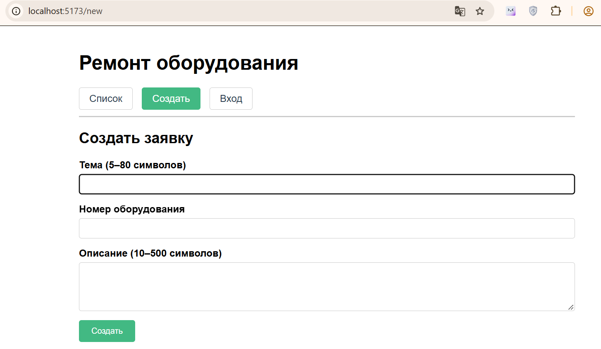
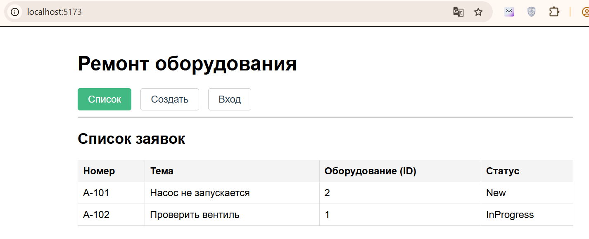

# Отчёт по ЛР4: Vue: компоненты и маршруты

## 1. Скриншоты




## 2. Схема: AppHeader снаружи, router-view внутри

```text
┌─────────────────────────────────────────────┐
│  App.vue                                    │
│  ┌───────────────────────────────────────┐  │
│  │  AppHeader  (router-link: /  /new  /login)
│  └───────────────────────────────────────┘  │
│  ┌───────────────────────────────────────┐  │
│  │  <router-view />                      │  │
│  │     сейчас один из экранов:           │  │
│  │     • TicketList   путь /             │  │
│  │     • TicketNew    путь /new          │  │
│  │     • Login        путь /login        │  │
│  └───────────────────────────────────────┘  │
└─────────────────────────────────────────────┘
## 3. Описание
Таблица получает массив через props, источник — ticketsStore.js.