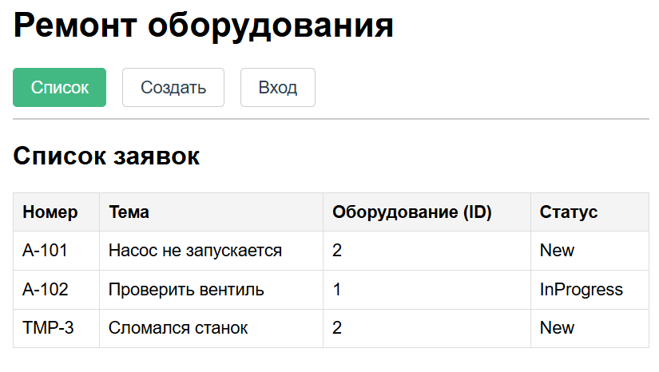
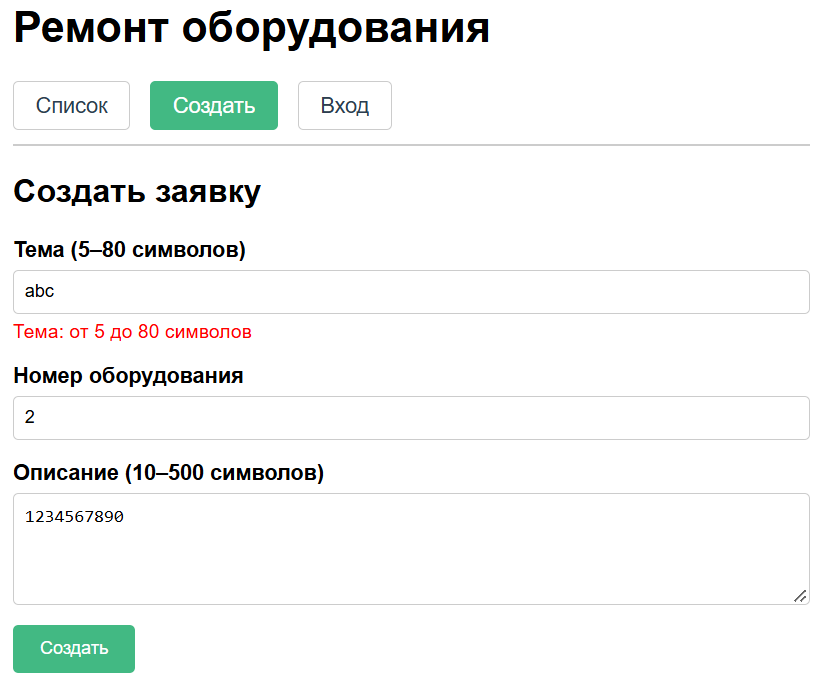

# Отчёт по ЛР5: Форма и список в памяти

## 1. Успешное создание

При вводе корректных данных (Тема: "Сломалась станок", ID: 2, Описание: 10+ символов) новая запись со статусом `New` появилась в списке. Произошел автоматический переход на главную страницу.

## 2. Отказ (короткая тема)

При вводе темы "abc" (менее 5 символов) заявка не добавилась. Под полем появилось сообщение об ошибке: "Тема: от 5 до 80 символов".

## 3. Проверка F5 (память)
После успешного создания заявки и нажатия клавиши F5 добавленная строка исчезла. Остались только исходные тестовые данные.
*Примечание: это ожидаемо, так как сервера и БД пока нет, данные хранятся только в оперативной памяти.*