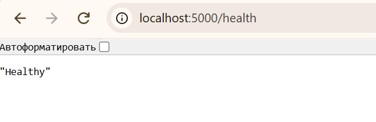
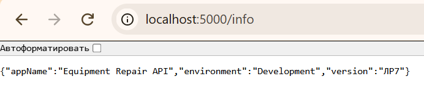
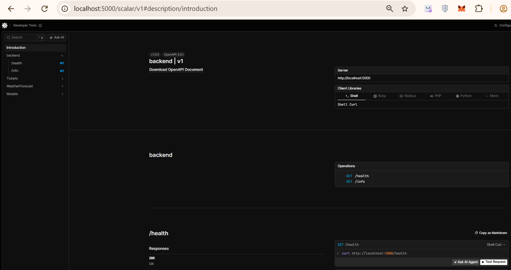

# Отчёт по ЛР7: Каркас ASP.NET Core Web API

## 1. Проверка служебных адресов

### GET /health

Эндпоинт возвращает статус 200 и строку "Healthy". Это подтверждает, что процесс сервера запущен.

### GET /info

Возвращает JSON с именем приложения, средой (Development) и версией (ЛР7).

## 2. Документация API (Scalar)

В режиме разработки доступна интерактивная документация по адресу `/scalar/v1`. В списке отображаются все доступные эндпоинты.

## 3. Внедрение зависимостей (DI)
Созданы папки `Controllers`, `Services`, `Models`, `Data`.
В `Program.cs` зарегистрирован сервис через DI:
`builder.Services.AddSingleton<ITicketService, TicketService>();`
Контроллер получает сервис через конструктор и не создает его через `new`.

## 4. Чеклист: /health ≠ создание заявки

| Утверждение | Да/Нет |
| :--- | :--- |
| /health возвращает 200 без тела заявки | Да |
| /health не принимает title, siteId, description | Да |
| Успешный /health не доказывает работу POST | Да |
| Создание главного объекта относится к ЛР8 | Да |
| README прямо объясняет это различие | Да |
| Swagger (Scalar) и /health проверены отдельно | Да |

**Примечание:** Данные заявок пока хранятся в памяти, после перезапуска сервера они пропадут. Настоящее создание заявок появится в ЛР8.