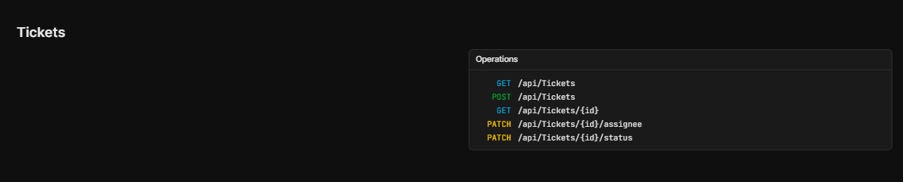
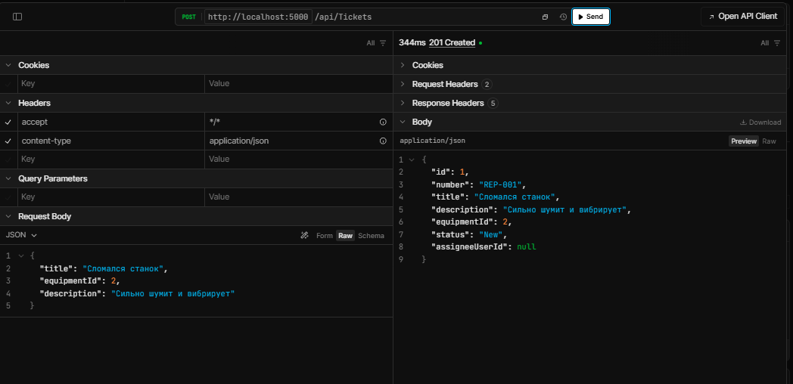
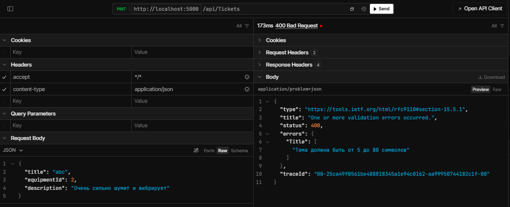
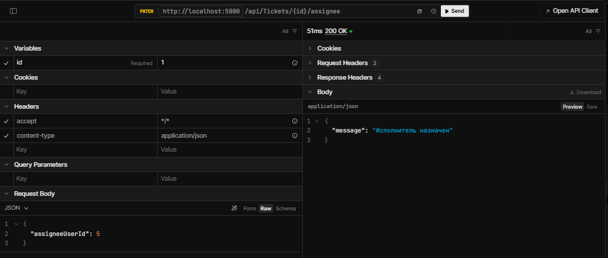
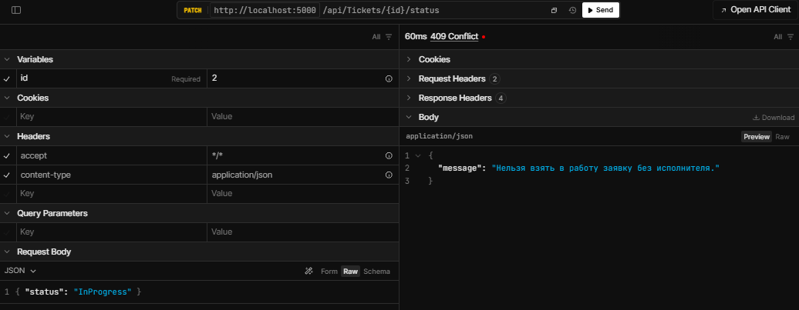

# Отчёт по ЛР8: REST и проверка полей

## 1. Общий вид API

В Scalar доступны все 5 маршрутов контроллера Tickets.

## 2. Проверка сценариев

### Успешное создание (201 Created)

Сервер вернул 201, присвоил id и number (REP-001), установил статус New.

### Ошибка валидации (400 Bad Request)

При отправке короткой темы (abc) сервер вернул 400 с текстом ошибки.

### Назначение исполнителя (200 OK)

Успешное назначение исполнителя на заявку.

### Ошибка правила процесса (409 Conflict)

Попытка перевести заявку в InProgress без исполнителя возвращает 409 Conflict.

## 3. Коллекция запросов
Файл коллекции находится в `/docs/api-collection/tickets.postman_collection.json`. Он содержит запросы для повторения успешных и ошибочных сценариев.

## 4. Логирование
При неожиданной ошибке на сервере пишется строка в лог, а клиенту отдается безопасный ответ без stack trace.