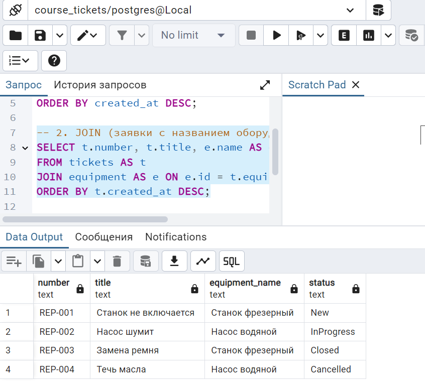
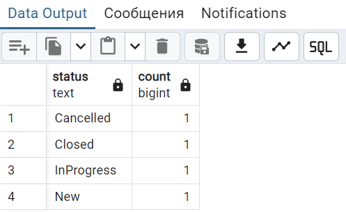
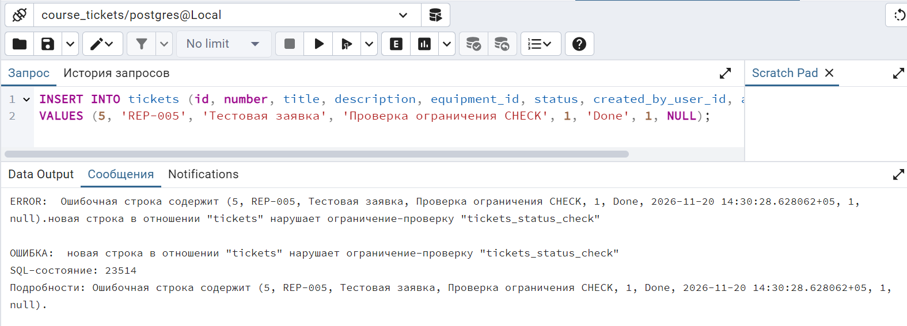
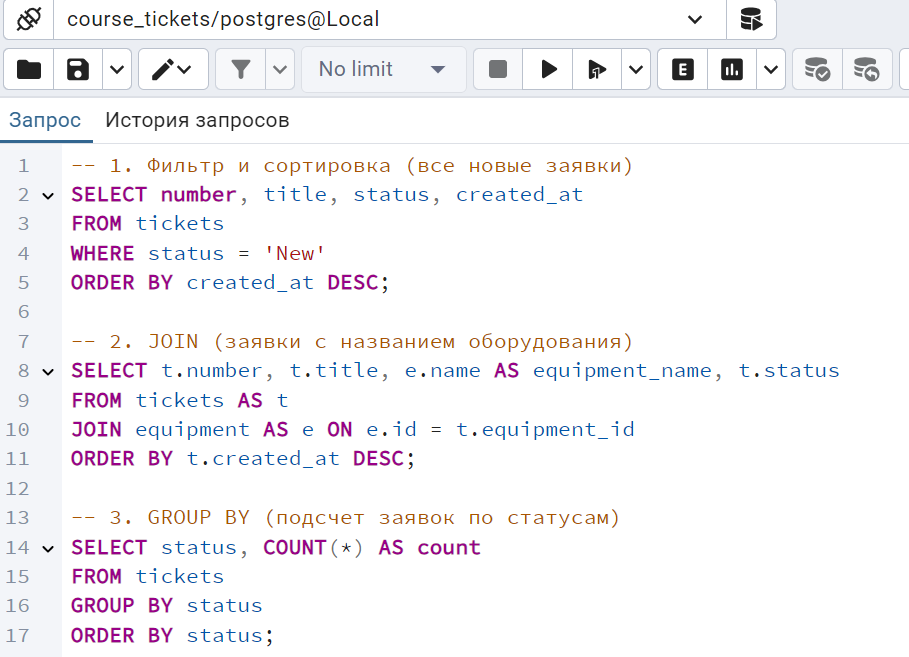

# Отчёт по ЛР9: PostgreSQL и SQL

## 1. Схема базы данных
Файл `db/schema.sql` содержит создание таблиц `users`, `equipment` и `tickets` с первичными ключами (PK), внешними ключами (FK) и ограничением `CHECK` на статусы.

## 2. Тестовые данные
Файл `db/seed.sql` наполняет базу: 3 пользователя, 2 единицы оборудования и 4 заявки (во всех четырех статусах).

## 3. Запросы

### Фильтр и сортировка (WHERE)

Выбирает только заявки со статусом 'New', отсортированные по дате.

### Соединение (JOIN)

Показывает заявки вместе с названием оборудования (а не просто ID).

### Группировка (GROUP BY)

Считает количество заявок в каждом статусе.

## 4. Проверка ограничения CHECK

Попытка вставить заявку со статусом 'Done' привела к ошибке, так как база данных разрешает только 4 статуса: New, InProgress, Closed, Cancelled.

## 5. Код запросов

Общий вид SQL-скриптов в pgAdmin.